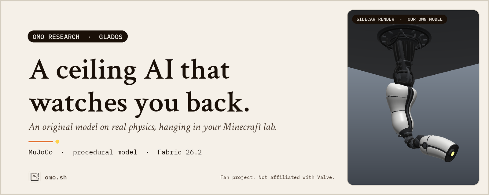
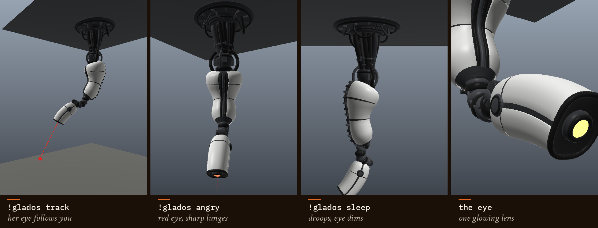
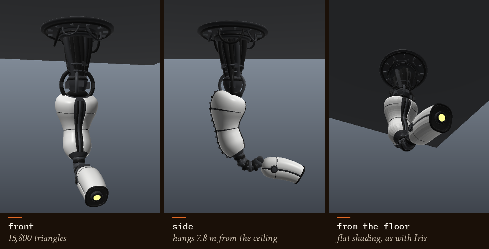
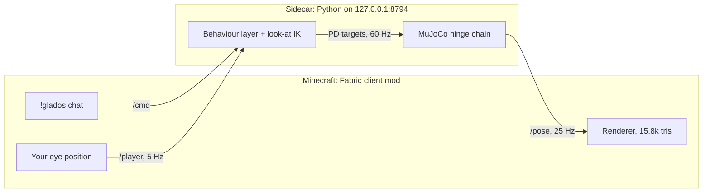

<picture>
  <source media="(prefers-color-scheme: dark)" srcset="docs/media/hero-dark.png">
  
</picture>

<h1 align="center">Omo GLaDOS</h1>

<p align="center">
  A <b>GLaDOS-style ceiling AI</b> for your Minecraft lab. Not a mob, not an animation:<br>
  a 2.7-tonne articulated body hanging on real MuJoCo physics, with an eye that follows you round the room.
</p>

<p align="center">
  <a href="https://github.com/omoresearch/omo-glados"><picture><source media="(prefers-color-scheme: dark)" srcset="docs/media/btn-star-dark.png"></picture></a>&nbsp;
  <a href="#quick-start"><picture><source media="(prefers-color-scheme: dark)" srcset="docs/media/btn-quickstart-dark.png"></picture></a>
</p>

<p align="center">
  <sub>⭐ <b>Star the repo to follow the lab.</b> &nbsp;·&nbsp; <a href="#quick-start">Quick start</a> &nbsp;·&nbsp; <a href="#how-it-works">How it works</a> &nbsp;·&nbsp; <a href="https://www.omo.sh">omo.sh</a></sub>
</p>

<p align="center">
  
  
  
  
  
</p>

<br>

## Straight from the sim

Every picture here is the model that ships in this repo, posed by the real physics and drawn by the sidecar's own
renderer. Nothing is painted, generated or staged.

<p align="center">
  
</p>

<p align="center">
  
  <br><sub>The model: 15,800 triangles of numpy lathe and sweep surfaces, six bodies, one glowing eye.</sub>
</p>

## In the game

She hangs in the robot lab of the [Omo Space](https://github.com/omoresearch/omo-space) world, next to a flock of
[Omo Microducks](https://github.com/omoresearch/omo-microduck), live on
[Twitch](https://www.twitch.tv/yiifannn). Stand under her, walk round, and the whole hanging body leans toward you
while the head tracks your eyes.

## Why this exists

A ceiling AI is all presence. It doesn't walk, it doesn't fetch: it hangs there and *watches*. That only works if
the body feels heavy. A 7.8-metre arm on a hinge chain has to swing, overshoot and settle; the head has to turn
first and drag the body after it.

So nothing here is animated. Every pose is a MuJoCo simulation of a 2,691 kg chain under gravity, driven by PD
servos toward targets from a small behaviour layer. When she lunges, the arm swings back. When she sleeps, the
head really drops.

At [Omo Research](https://www.omo.sh) we build agents that are **present**: they have a body, a place and a voice.
Omo GLaDOS is that idea at ceiling scale.

## What it does

| Feature | What you get |
|---|---|
| **Real physics** | A 13-joint hinge chain in MuJoCo at 480 Hz physics / 60 Hz control, PD with gravity compensation, on one CPU core. She sways, overshoots and settles. |
| **Watches you** | The mod sends your eye position 5 times a second. Within 12 m she tracks you with look-at IK, leans the whole body your way and tilts her head when you move. |
| **Moods** | Angry (red eye, jerky lunges), sleep (droops, eye dims), scan, nod, shake, bow, a 112 BPM dance, and an 18-second spooky dance that ends with her eye 1.5 m from yours. |
| **Hangs anywhere** | `!glados here` finds the ceiling above your head and hangs her from it. Scale and yaw are chat commands; everything is saved. |
| **Original model** | Procedural geometry written in Python (no Valve assets): 15,800 triangles, smooth normals, a fullbright eye that changes colour with her mood. Works with Sodium and Iris. |
| **Swappable models** | The sidecar can serve any model in its documented asset format and switch live (`!glados model <name>`). Only the procedural one ships. |
| **Chat-controlled** | `!glados track`, `!glados angry`, `!glados look me`, `!glados sleep`. Handled client-side, never sent to the server. |
| **Stream-ready** | Commands tagged `"from":"twitch:<user>"` may only use gestures and moods. They cannot reset her, switch models or move her. |
| **Talks back** *(optional, bring your own voice)* | With Simple Voice Chat and a voice backend you run yourself, hold push-to-talk near her and her reply plays from her head, in positional audio. |

## Quick start

You need **Minecraft Java 26.2** with **Fabric Loader** and **Fabric API**, plus Python 3.12+, a JDK 21+ and
`git`. Tested on Linux x86_64. macOS should work but has not been tested yet. If you have
[`uv`](https://github.com/astral-sh/uv), setup uses it.

**1. Start the body (the sidecar)**

```bash
git clone https://github.com/omoresearch/omo-glados ~/omo-glados
cd ~/omo-glados/sidecar && ./setup.sh
OMP_NUM_THREADS=1 nice -n 10 .venv/bin/python server.py
```

`setup.sh` creates a virtualenv with `mujoco`, `numpy` and `pillow`, validates the procedural model and runs a
one-second smoke test. Nothing else is downloaded. To keep it running, there is a user service in
[`sidecar/contrib/`](sidecar/contrib/glados-sim.service).

**2. Build and install the mod**

There is no release jar yet, so build it (plain `javac`, no Gradle):

```bash
cd ~/omo-glados/mod
python3 deps/fetch.py      # optional: Simple Voice Chat API for the voice plugin (hash-checked)
MC_LIBRARIES=/path/to/launcher/libraries MC_MODS=/path/to/instance/mods ./build.sh
cp build/glados-1.0.0+mc26.2.jar /path/to/instance/mods/
```

**3. Meet her**

Stand under a ceiling at least 9 blocks high and type in chat:

```
!glados here        hang her from the ceiling above you
!glados look me     she looks straight at you
!glados angry       red eye, lunges
!glados sleep       she droops; !glados wake brings her back
!glados spooky      don't stand too close
```

<details>
<summary><b>Every chat command</b></summary>

| Command | Effect |
|---|---|
| `!glados` / `!glados help` | help, plus the active model's credit |
| `!glados idle` / `track` / `angry` / `scan` / `nod` / `shake` / `bow` / `dance` / `spooky` / `sleep` / `wake` / `reset` | behaviours (`spookydance` and `creepy` also work) |
| `!glados look left` / `right` / `up` / `down` / `me` | one glance |
| `!glados here` | anchor her to the underside of the first solid block above your head (saved) |
| `!glados scale <0.25-4>` | blocks per sim metre (default 1: she is about 7.5 blocks tall) |
| `!glados yaw <deg>` | turn the whole model about the anchor |
| `!glados models` / `!glados model <name>` | list the sidecar's models / switch live |

The space is optional: `!gladoshere` and `!gladosdance` work too. Unknown `!glados` lines get a usage reply and
never leak to the server chat.
</details>

## How it works



- **Sidecar** (`sidecar/`): one Python process steps a six-body, 13-hinge chain in MuJoCo at a fixed 60 Hz (8
  physics substeps per tick). A scripted behaviour layer picks gaze targets and gestures; Jacobian look-at IK turns
  them into joint targets; PD servos with gravity compensation drive the joints, so the arm still hangs and sways
  like a pendulum. Pose snapshots go out over loopback HTTP.
- **Mod** (`mod/`): a Fabric client mod. It fetches the model once, polls poses at 25 Hz on a background thread
  and draws each body part every frame, so a network hiccup never stalls the game. It maps MuJoCo's z-up metres
  to Minecraft blocks, posts your eye position and handles chat and voice.
- **Contract**: the full HTTP API is in [`sidecar/CONTRACT.md`](sidecar/CONTRACT.md). Anything that speaks it can
  drive her.

Cost on our streaming PC: about **6% of one core** and 62 MB of RAM for the sidecar, a steady 60 Hz with 0
overruns, and about 0.15-0.25 ms of physics per tick.

### Voice (optional)

The mod includes a Simple Voice Chat plugin: when you are within 16 blocks and looking at her, your push-to-talk
audio goes to a voice backend on `ws://127.0.0.1:8793/svc`, and her reply plays from her head as she sways. **No
backend is included.** Ours is a private realtime-voice persona, and no voice audio ships here. The wire protocol
(PCM16 48 kHz over a loopback WebSocket, plus a few JSON control messages) is in
[`sidecar/CONTRACT.md`](sidecar/CONTRACT.md#voice-optional-backend-not-included), so you can bring your own.
Without a backend, the mod simply stays quiet.

## Verified

Re-run against this exact tree (Linux x86_64, Minecraft 26.2 libraries, JDK 25):

| Suite | Result |
|---|---|
| `mod/build.sh`: javac against the 26.2 client + Fabric API + SVC API | **builds** (75 kB jar) |
| `mod/build.sh test`: harness against the v3 and v1 stand-in sidecars (parser, model/atlas/skinning, mapping, live model switch, reconnects) | **204/204 pass** |
| `mod/build.sh voicetest`: PCM framing, voice config, mic-focus arbitration, Opus round trip | **21/21 pass** |
| `mod/test/check_refs.py`: every Minecraft/Fabric/SVC member the jar calls exists in the real jars | **161 refs, 0 missing** |
| `sidecar/test_headless.py`: model, joints, idle, settle, aim, auto-track, every command, moods, talk, reset, 2-minute stress, spooky dance | **23/23 pass** |
| `sidecar/test_v3.py`: asset format, sim built from an asset, dance, live model switch in-process and over a side HTTP instance, persistence | **23/23 pass** |

## Build from source

```bash
cd mod
python3 deps/fetch.py          # optional: Simple Voice Chat API (hash-checked)
MC_LIBRARIES=/path/to/launcher/libraries MC_MODS=/path/to/instance/mods ./build.sh
python3 test/fake_sidecar.py 8789 &   # a stand-in sidecar for the harness
./build.sh test http://127.0.0.1:8789
```

The mod builds with plain `javac`, because Minecraft 26.2 ships unobfuscated. No Gradle is needed. See
[`mod/README.md`](mod/README.md) and [`sidecar/README.md`](sidecar/README.md) for the deep dive: joint limits, PD
tuning, IK, the spooky dance, the asset format and the rendering pipeline.

## Honest limitations

- No collisions: she can't hit the walls, the ceiling or you. The joint limits keep her compact, so give her a
  room at least 9 blocks high.
- There is no trained policy: the "brain" is a scripted behaviour layer on real physics, not a learned one.
- The voice backend is not in this repo. The mod's voice plugin and its protocol are, so you can bring your own.
- No release jar yet: build the mod from source.
- Singleplayer and client-side only. Other players do not see her.
- In-game shots of exactly this model are still to come; the pictures above are the sidecar's own renders.

## Credits

Physics by [MuJoCo](https://github.com/google-deepmind/mujoco) (Google DeepMind, Apache-2.0). Full list in
[THIRD_PARTY_NOTICES.md](THIRD_PARTY_NOTICES.md). Built by **[Omo Research](https://www.omo.sh)**. Code and model
are [MIT](LICENSE).

**Omo GLaDOS is a fan project.** GLaDOS and Portal belong to Valve Corporation. This project is not affiliated
with or endorsed by Valve, and includes no Valve assets, code or audio.

**NOT AN OFFICIAL MINECRAFT PRODUCT. NOT APPROVED BY OR ASSOCIATED WITH MOJANG OR
MICROSOFT.**

<br>

<p align="center">
  <a href="https://github.com/omoresearch/omo-glados"><picture><source media="(prefers-color-scheme: dark)" srcset="docs/media/btn-star-dark.png"></picture></a>
</p>
<p align="center">
  <a href="https://github.com/omoresearch/omo-glados/stargazers"></a>
  <br><sub>⭐ Star the repo to follow the lab.</sub>
</p>

<br>

<p align="center">
  <a href="https://www.omo.sh"></a>
  <br><sub><i>The next interface isn't a chat window.</i> · Omo Research · <a href="https://www.omo.sh">omo.sh</a></sub>
</p>
